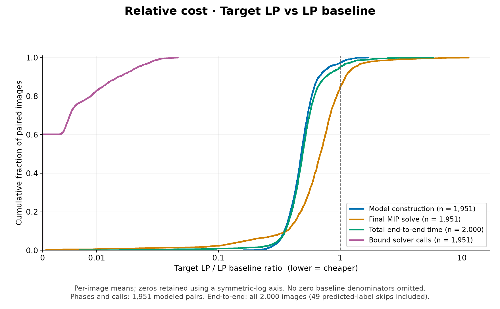
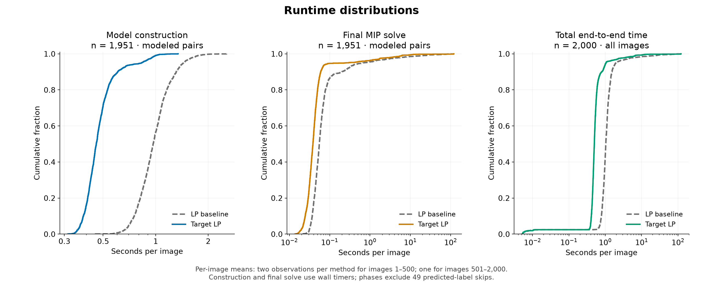
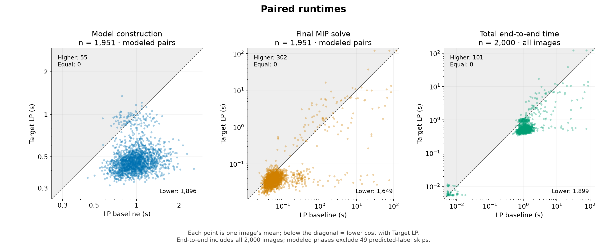
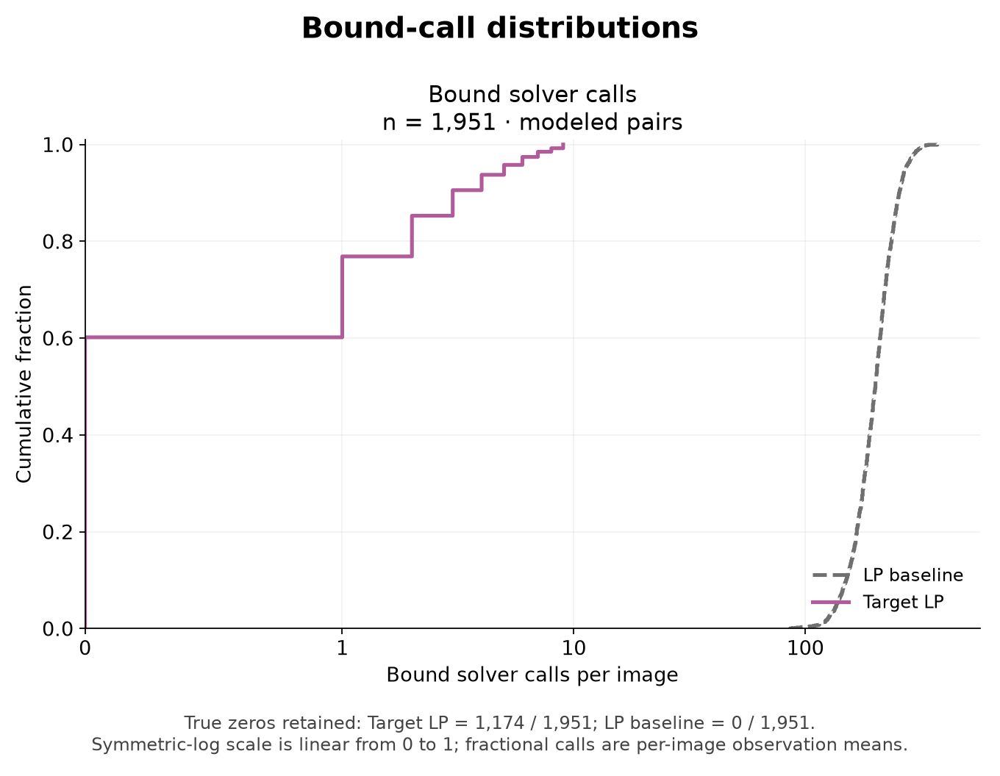
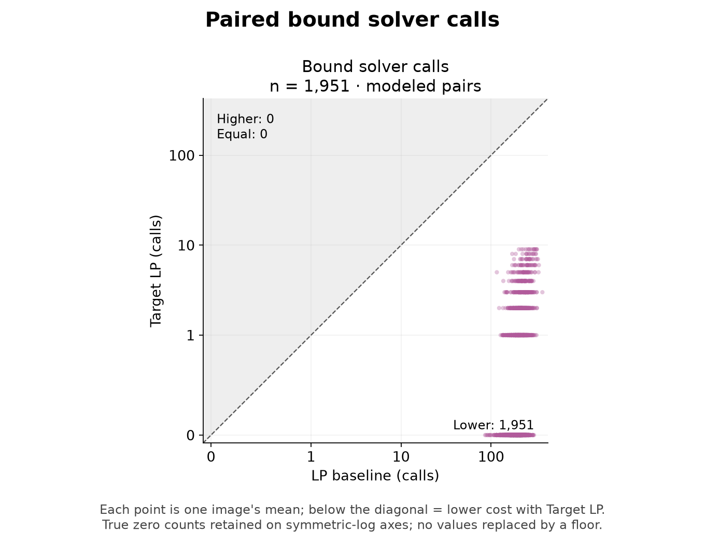

# Verifying 2,000 MNIST images with Target LP

We tested whether small changes to a handwritten digit could make Wong and Kolter’s WK17a classifier
give another digit an equal or higher score. The **true label** is the digit assigned by MNIST. Each
of the other nine digits is a **target label**. Each pixel could change by at most 0.1 while staying
between 0 and 1.

The two methods use linear programs (LPs) to bound network scores. The new method, **Target LP**,
bounds the target score minus the true-label score on the same image. On the first 2,000 MNIST test
images, it cut total verification time from 57.4 to 29.2 minutes (49.2%).

## What Target LP changes

The LP baseline uses LPs to narrow the range of values that each hidden neuron can take, then bounds
each target score separately. The target’s maximum and the true label’s minimum can occur on
different images.

Target LP first subtracts the true score’s interval lower bound from the target score’s interval
upper bound. If the upper bound is below zero, the target cannot tie the true label and is ruled
out. Otherwise, Target LP solves a linear program to bound the difference more tightly. On image 19,
the separate intervals allowed digit 5 to score up to about 3.81 above the true digit 3. The LP
proved that digit 5 scored at least 0.486 below digit 3 on every allowed image.
[Score bounds for image 19](https://github.com/vtjeng/MIPVerify.jl/blob/dcdd36d12449a82a2a07c3cd4c1bfbb32d623e84/pairs/2026-11-25-wk17a-target-lp/example-score-bounds.csv)

The final mixed-integer program (MIP) checks whether any remaining target can tie or exceed the
true-label score. A verdict either rules out every target or produces an allowed image on which a
target ties or exceeds that score. With a 120-second limit for the main solve, the LP baseline
reached a verdict on 1,998 images and Target LP on 1,997. They agreed wherever both reached a
verdict. Both methods timed out on image 63 in the first run. Only the LP baseline timed out on
image 19, and only Target LP timed out on images 584 and 1572. Target LP remains opt-in
(`tightening_algorithm = target_lp`).

## Timing and bound calls

Tightening bounds accounted for 856 seconds, about half the total saving. Of those 856 seconds, 688
came from spending less time inside bound solver calls (731 seconds down to 43). The table includes
timeouts. Differences use unrounded times.

| Phase                                  | LP baseline (s) | Target LP (s) | Seconds saved | Share of savings |
| :------------------------------------- | --------------: | ------------: | ------------: | ---------------: |
| Tightening bounds                      |         1,184.1 |         328.1 |         856.0 |            50.5% |
| Building the rest of the model         |           777.5 |         627.2 |         150.3 |             8.9% |
| Final MIP solve                        |         1,469.4 |         782.0 |         687.4 |            40.6% |
| Outside model construction and solving |            14.1 |          14.1 |          −0.1 |          −0.005% |
| Total                                  |         3,445.0 |       1,751.3 |       1,693.7 |             100% |

## Per-image results

All five plots compare the same images under the two methods. End-to-end time includes all 2,000.
The other measures cover the 1,951 images that needed a model. The network already misclassified the
remaining 49.

Each ratio divides Target LP’s time or call count by the LP baseline’s for the same image. Values
below 1 favor Target LP. The median per-image time ratio was 0.49 (10th and 90th percentiles, 0.35
and 0.76). Target LP was faster by more than 1% on 1,893 images, slower by more than 1% on 95, and
within 1% on 12.

Model construction was faster on most images. To read the curves, pick a time on the horizontal
axis. The height gives the fraction of images that finished that phase within that time.

Each point pairs the two times for one image. Below the diagonal, Target LP was faster. Even after
removing the ten images that saved the most time, the total fell by 40.2%.

Interval arithmetic ruled out 15,562 of the 17,559 possible targets before an LP was needed. Target
LP made 1,997 bound solver calls in total, down from 393,502. On 1,174 images it needed none.

Target LP made fewer bound solver calls on every one of the 1,951 images that required a model.

## Measurement and reproduction

Each image ran on the same CPU core under both methods with HiGHS using one thread. We warmed up
each process before timing. The first 500 images ran twice per method and the rest ran once. We
averaged repeats for each image so that every image counted equally. Verdict counts use the first
run. The baseline’s total time on those repeated images differed by 12.3% between runs. Resampling
the paired images gave a 95% interval of 38.4–57.8% for the time reduction, measuring sensitivity to
the choice of images.

The published implementation also tries an LP if an interval bound equals zero exactly. We rechecked
all 17,559 comparisons and found no such equality, so it requests the same LPs as the timed version
on these images.

The archive records the two versions tested (`144974b` and `80ef0fe`), the Intel i7-8700K and
Julia/HiGHS environment, the 20-second limit per bound solve, and commands to reproduce every figure
and timing.
[Data, figures and reproduction instructions](https://github.com/vtjeng/MIPVerify.jl/tree/dcdd36d12449a82a2a07c3cd4c1bfbb32d623e84/pairs/2026-11-25-wk17a-target-lp)
·
[Earlier experiments and exact checks of three adversarial images](https://github.com/vtjeng/MIPVerify.jl/blob/8caeeb6288db9a7863ea5fe850256935299f1258/benchmarks/reports/2026-11-25-target-lp.md#exact-witness-checks)
