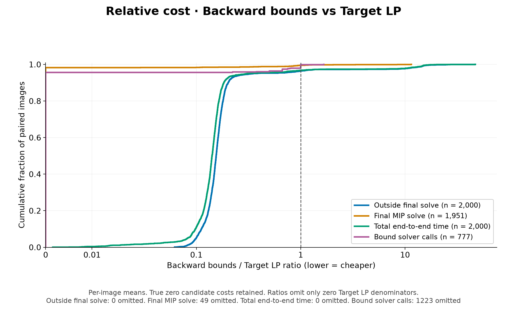
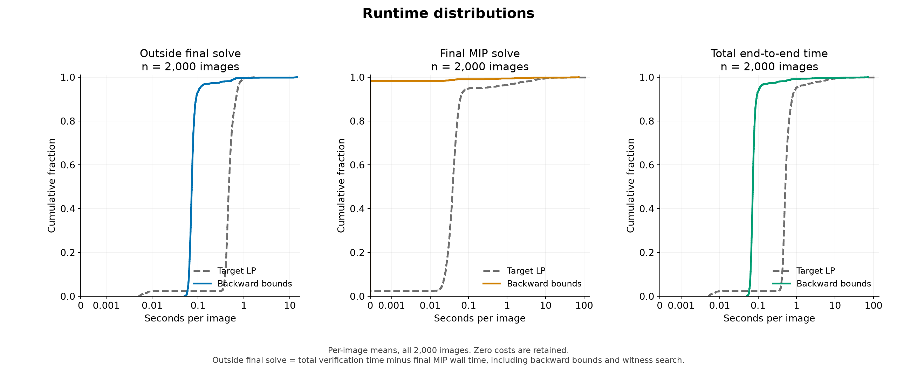
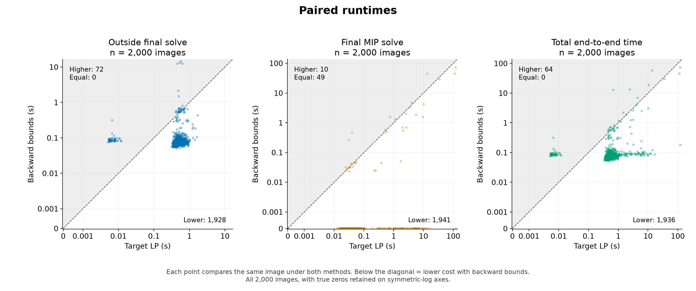
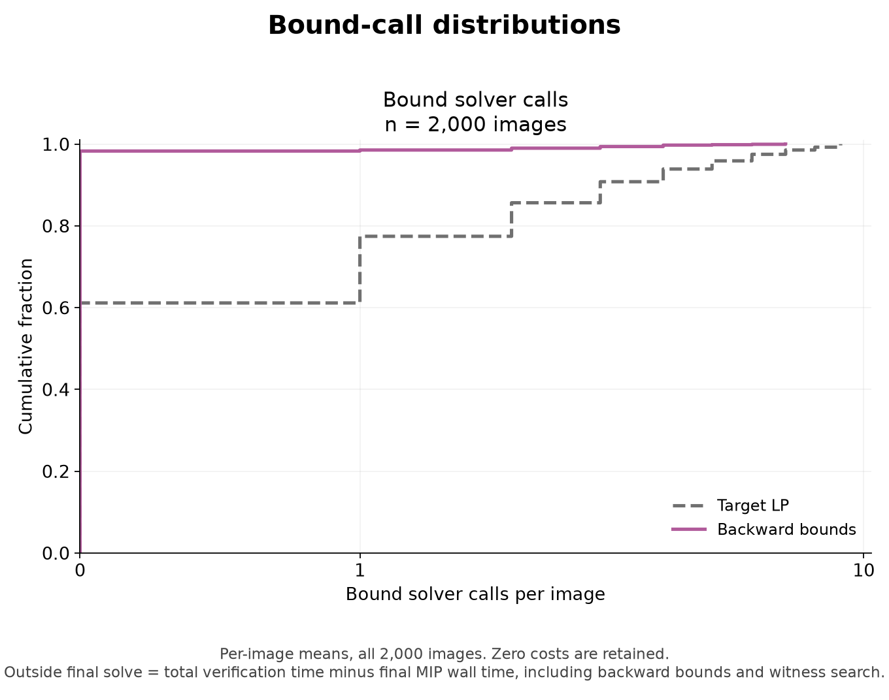
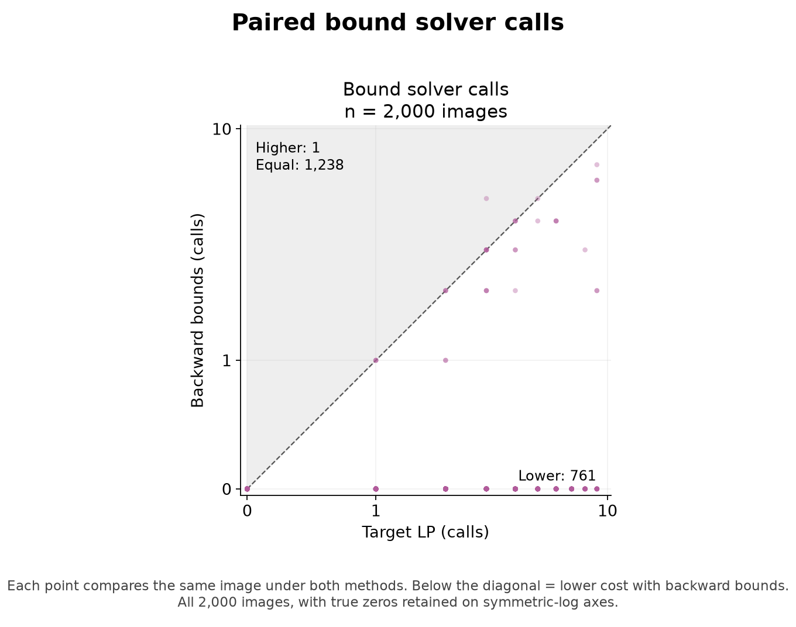

# Verifying 2,000 MNIST images with backward bounds

We tested Wong and Kolter’s WK17a classifier on the first 2,000 MNIST test images. The **true
label** is the digit assigned to an image. Each other digit is a **target label**. A change is
allowed if every pixel stays between 0 and 1 and changes by at most 0.1. An allowed change produces
an **adversarial example** if a target scores at least as highly as the true label. If no such
change exists, the image is robust.

**Backward bounds** reduced total verification time from 29.5 minutes with Target LP to 7.4 minutes
(75.1%). Removing the ten images with the largest savings still left a 75.8% reduction. Target LP
resolved 1,997 images on its first pass. Backward bounds resolved all 2,000 on each pass, with 1,874
robustness certificates and 126 adversarial examples.

## How the verifier uses the network

Target LP builds a mixed-integer model and uses intervals and linear programs (LPs) to screen target
labels before the final solve. The new verifier bounds the target score minus the true-label score
by working backward through the network’s layers. Its backward calculation uses linear bounds for
the network’s rectified linear units, following the approach used in CROWN.
[CROWN paper](https://arxiv.org/abs/1811.00866)

1. Starting from the allowed pixel ranges, use interval arithmetic to bound the input to each hidden
   neuron. In deeper layers, tighten those intervals by working back toward the pixels. Keep the
   bounds for this image.
2. For each target label $j$, bound its score minus the true label’s score, $f_j(x)-f_i(x)$, on the
   same perturbed image $x$. Start at the outputs and work back toward the pixels. A rectified
   linear unit (ReLU) outputs $\max(0,z)$. With a known input sign, its action is exact. Otherwise
   use a line that bounds its contribution from above. This gives a linear expression in the pixels
   plus a constant. Its maximum over the allowed pixel ranges uses the upper endpoint for each
   positive coefficient and the lower endpoint for each negative one. If all nine upper bounds are
   strictly negative, the image is robust. A bound equal to zero keeps a possible tie in play.
3. For any target still in play, use gradients to search for an allowed image that increases the
   score difference. Clip each step to the pixel limits and check the resulting scores with outward
   rounding. An allowed image that passes this check proves that the original digit is vulnerable.
4. If a target remains and the search found no example, build the Target LP mixed-integer program
   (MIP). Reuse the hidden-neuron bounds from step 1 in its ReLU constraints. Whenever a neuron's
   input has a fixed sign, the MIP can represent it without a binary decision. If the solver returns
   an input, check its pixel values and scores. Move out-of-budget pixels to the nearest allowed
   floating-point value and check the scores again, using exact arithmetic for uncertain
   comparisons. Try nearby inputs if needed. If none passes, report the image as unresolved.

## Verification time

Backward bounds directly certified 1,844 images. The search found 122 adversarial inputs. Only 34
images required the MIP. Reused hidden bounds are the default for this verifier. Bound tightening
needed 1,997 LP calls with Target LP and 104 with backward bounds. Time outside the final MIP solve
includes screening, witness search, any model construction, and bound LPs.

| Verification time           | Target LP (s) | Backward bounds (s) | Seconds saved |
| --------------------------- | ------------: | ------------------: | ------------: |
| Outside the final MIP solve |         990.5 |               225.6 |         764.9 |
| Final MIP solve             |         781.3 |               215.6 |         565.7 |
| Total                       |       1,771.9 |               441.3 |       1,330.6 |

Image 212 had the largest slowdown. It still needed a MIP, and its mean time rose from 13.9 to 57.9
seconds.

### What reusing hidden-neuron bounds saved

Both runs used the same backward screen and gradient search. Only the MIP’s hidden-neuron bounds
changed.

| Reuse hidden bounds in the MIP | Time (s) | Resolved | Unresolved timeout | Input failed verification |
| ------------------------------ | -------: | -------: | -----------------: | ------------------------: |
| No                             |    556.0 |    1,997 |                  1 |                         2 |
| Yes                            |    439.1 |    2,000 |                  0 |                         0 |

Reuse resolved images 480, 584, 952, which the fresh MIP had left unresolved. Without reuse, image
584 timed out and the proposed inputs for images 480, 952 failed exact validation. Most of the
timing gain came from images 584, 1572. Removing those two leaves a 3.2% reduction.
[Per-image reuse comparison](https://github.com/vtjeng/MIPVerify.jl/blob/53e17cf8b642e4976d325d432048c87174d8d310/pairs/2026-11-26-wk17a-verified-backward-bounds/reuse-comparison.csv)

### Solve status and verdict flips

Counts use the first observation of each image under each method.

| Status                          | Target LP | Backward bounds |
| ------------------------------- | --------: | --------------: |
| `INFEASIBLE`                    |      1872 |              30 |
| `NO_SOLVER`                     |         0 |            1966 |
| `OPTIMAL`                       |        76 |               4 |
| `SKIPPED_PREDICTED_IN_TARGETED` |        49 |               0 |
| `TIME_LIMIT`                    |         3 |               0 |

`NO_SOLVER` records a result reached without running the integer solver. The verification-outcome
table below distinguishes robustness certificates from adversarial examples.

**Solve status**

| Transition (Target LP → Backward bounds)      | Count |                                                                                                                                                                                                           MNIST test image IDs |
| --------------------------------------------- | ----: | -----------------------------------------------------------------------------------------------------------------------------------------------------------------------------------------------------------------------------: |
| `INFEASIBLE` → `NO_SOLVER`                    |  1844 |                 [All 1,844 image IDs](https://github.com/vtjeng/MIPVerify.jl/blob/53e17cf8b642e4976d325d432048c87174d8d310/pairs/2026-11-26-wk17a-verified-backward-bounds/image-ids/solve_status-INFEASIBLE-to-NO_SOLVER.csv) |
| `OPTIMAL` → `NO_SOLVER`                       |    72 |                       [All 72 image IDs](https://github.com/vtjeng/MIPVerify.jl/blob/53e17cf8b642e4976d325d432048c87174d8d310/pairs/2026-11-26-wk17a-verified-backward-bounds/image-ids/solve_status-OPTIMAL-to-NO_SOLVER.csv) |
| `SKIPPED_PREDICTED_IN_TARGETED` → `NO_SOLVER` |    49 | [All 49 image IDs](https://github.com/vtjeng/MIPVerify.jl/blob/53e17cf8b642e4976d325d432048c87174d8d310/pairs/2026-11-26-wk17a-verified-backward-bounds/image-ids/solve_status-SKIPPED_PREDICTED_IN_TARGETED-to-NO_SOLVER.csv) |
| `TIME_LIMIT` → `INFEASIBLE`                   |     2 |                                                                                                                                                                                                                      584, 1572 |
| `TIME_LIMIT` → `NO_SOLVER`                    |     1 |                                                                                                                                                                                                                             63 |

**Semantic outcome**

| Transition (Target LP → Backward bounds)                            | Count | MNIST test image IDs |
| ------------------------------------------------------------------- | ----: | -------------------: |
| `time_limit_unresolved` → `adversarial_example_found_or_best_known` |     1 |                   63 |
| `time_limit_unresolved` → `certified_no_adversarial_example`        |     2 |            584, 1572 |

Target LP timed out on images 63, 584, 1572 on the first pass and 63, 584 on the second. The two
methods agreed on every image for which both reached a verdict.

## Checks on bounds and adversarial inputs

Backward bounds round outward so that every allowed activation remains possible. Independent
rational calculations confirmed that all 163,336 hidden-neuron intervals reused on the 34 fallback
images contain every possible activation over the allowed input box. Robustness verdicts from the
final MIP still depend on HiGHS’s numerical tolerances.
[Full-domain bound checks](https://github.com/vtjeng/MIPVerify.jl/tree/75135e0bd6ef43f61c9d4285f803aa5484dc82b5/pairs/2026-11-25-wk17a-backward-bounds/audit)
Across their recorded observations, the repository’s original LP runs independently certified the
same 1,874 images.
[Original LP records](https://github.com/vtjeng/MIPVerify.jl/tree/dcdd36d12449a82a2a07c3cd4c1bfbb32d623e84/pairs/2026-11-25-wk17a-target-lp/runs)

In the prototype, four MIP-returned inputs exceeded the exact pixel budget by about 3.3 × 10⁻¹⁷. On
image 952 the target score also fell about 4.7 × 10⁻¹³ below the true score. The solver accepted
those differences within tolerance. Only proposed pixel coordinates are rounded inward. After
clipping, exact evaluation confirmed the inputs for images 212, 480 and 1193. Image 952 required one
projected gradient step of size 10⁻⁹. In this benchmark, independent exact replay accepted all 252
returned inputs across both passes, including all eight from the MIP.
[Exact replay of the timed inputs](https://github.com/vtjeng/MIPVerify.jl/tree/53e17cf8b642e4976d325d432048c87174d8d310/pairs/2026-11-26-wk17a-verified-backward-bounds/audit)

## Per-image results

A ratio below 1 favors backward bounds. Ratios use images with positive Target LP cost for the
measure. The median per-image end-to-end time ratio was 0.14. Backward bounds were faster by more
than 1% on 1,935 images, slower by more than 1% on 64, and within 1% on 1. The slower group includes
all 49 images that Target LP skipped because the network already misclassified them.



At a given time, the height of each curve gives the fraction of images that finished within that
time. A zero final-solve time means the method answered without calling the MIP.



Each point pairs the times for one image. Points below the diagonal took less time with backward
bounds.



Backward bounds needed no bound LPs on 1,966 images. Target LP needed none on 1,223.



Among all 2,000 image pairs, the backward verifier used fewer bound LPs on 761, the same number on
1,238, and more on 1.



## Measurement and reproduction

Each image ran twice under each method on the same physical core, with the order reversed across
cores. HiGHS used one thread, with 20 seconds for each bound LP and 120 seconds for the final solve.
Setup and warm-up were recorded separately. Times sum the per-image means. The Target LP runs took
1,790.8 and 1,753.0 seconds. The backward verifier took 464.1 and 418.5 seconds. The larger
difference between repeats of the same method was 9.8%. Resampling complete image pairs gave a 95%
interval of 65.4–84.1% for the reduction. The separate comparison of bound reuse ran once per
setting on a dedicated physical core.

From the repository root, run the standalone WK17a verifier with the benchmark environment:

```sh
OPENBLAS_NUM_THREADS=1 JULIA_NUM_THREADS=1 julia --project=benchmarks \
  benchmarks/backward_margin_screen.jl --samples 1:2000 --out /tmp/wk17a-backward
```

[Raw paired timing records, solver statuses, figures and replay instructions](https://github.com/vtjeng/MIPVerify.jl/tree/53e17cf8b642e4976d325d432048c87174d8d310/pairs/2026-11-26-wk17a-verified-backward-bounds)
