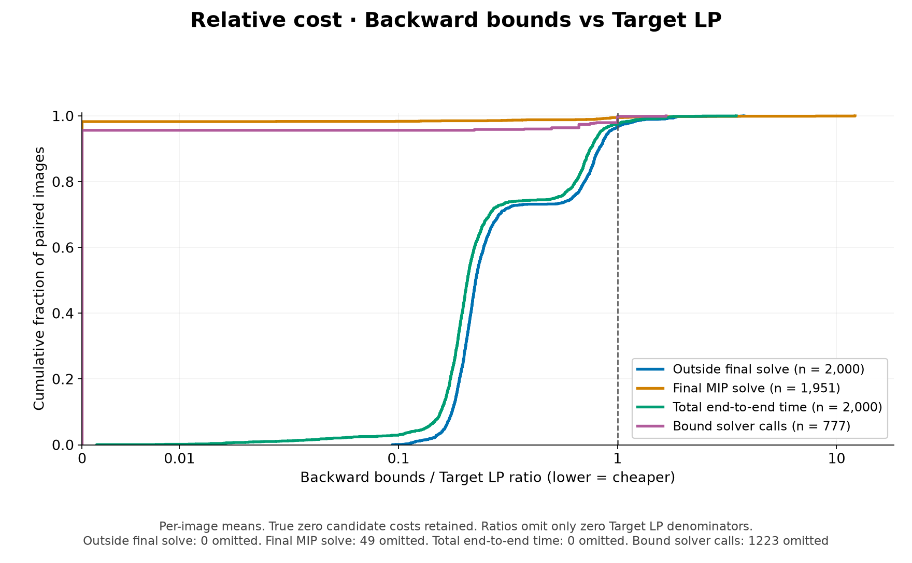
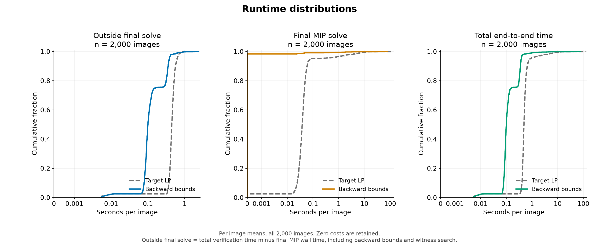
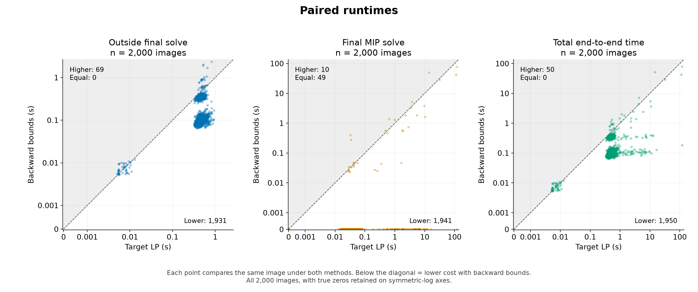
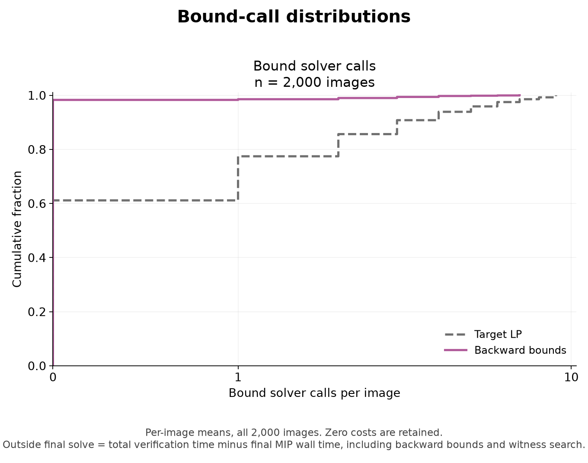
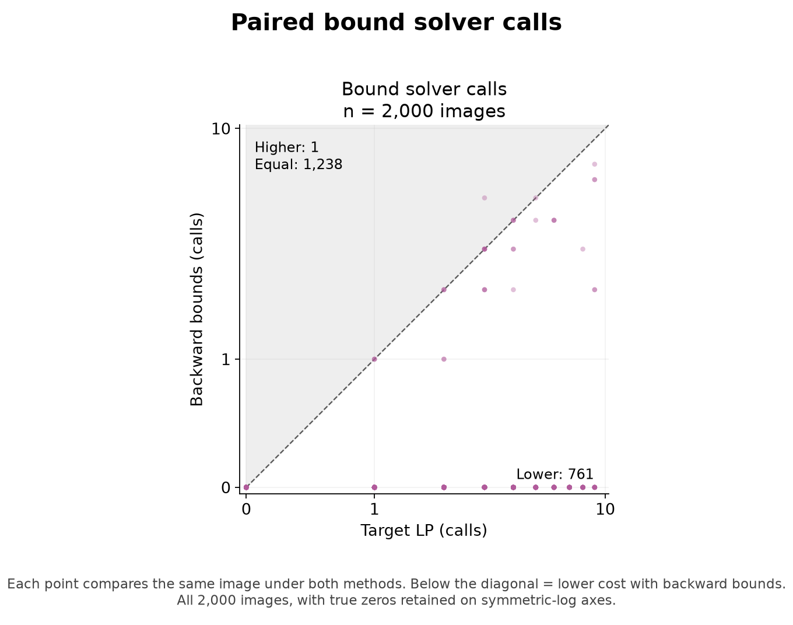

# Public feasibility verification on 2,000 WK17a images

This comparison calls `MIPVerify.find_adversarial_example` on MNIST test images 1–2,000 with the
WK17a network. Both configurations use the same implementation and settings. For the feasibility
objective, the candidate enables `backward_screen`, the public default. The baseline disables it.
Both keep the original-input shortcut for images the network already misclassifies.

The public screen reduced total verification time by **67.3%, with a ±1.4 percentage point
repeat-noise allowance**, from **1,687 to 550.9 seconds** when summing per-image means. The two
repeats showed reductions of **67.18% and 67.50%**. The allowance uses the larger relative
difference between unchanged-method repeat totals, 1.36% for the default verifier. The baseline
totals differed by 0.382%. Each relative difference uses that method’s mean total as its
denominator. The paired-image bootstrap interval was 58.2–75.6%, measuring sensitivity to the image
mix. Removing the ten largest per-image savings left a 65.7% reduction.

Both repeats gave the same routes and public verdicts. The default certified 1,844 images through
backward bounds, retained 49 original-input shortcuts, and found 68 corner and five PGD witnesses.
It built 34 solver models, which yielded 30 robustness certificates and four checked witnesses. All
2,000 images reached a verdict. The baseline built 1,951 models and left images 63 and 584
unresolved at the time limit.

| Measure                                             | Target LP only | Public default |
| --------------------------------------------------- | -------------: | -------------: |
| Total seconds, repeat 1 / 2                         |  1,690 / 1,684 |  554.7 / 547.1 |
| Images building a model                             |          1,951 |             34 |
| Robust images, each repeat                          |          1,873 |          1,874 |
| Publicly verified adversarial examples, each repeat |            125 |            126 |
| Unresolved images, each repeat                      |              2 |              0 |
| Bound LP calls, each repeat                         |          1,997 |            104 |

The gain comes from avoiding model construction on 1,917 images. Among the first 500 images, seven
built models under both methods in both repeats. Their summed mean time increased from 28.31 to
63.96 seconds, with a median per-image ratio of 1.501. Image 212 accounted for 36.72 seconds of the
additional time. These warmed feasibility measurements support retaining the public screen for this
workload.

The [timing tables](metrics.md), [status and verdict transitions](transitions.md),
[summary](summary.json), and [paired per-image means](paired-means.csv) are generated from the
[recorded observations](runs/). The plots use the label “Backward bounds” for the public default and
“Target LP” for the baseline.

The corresponding hosted experiment on RSL18a has separate measurement conditions and results.
[RSL18a comparison](rsl18a/README.md)

## Per-image results

The ratio curves show the distribution of costs over all paired images. Ratios omit only zero
baseline denominators. Absolute plots retain zero costs.



The runtime distributions show the fixed-cost clusters and the long solver tail. Each scatter point
pairs one image's mean costs under both methods.





The bound-call figures show how many images avoid optimization-based tightening. The default used
fewer bound LPs on 761 images, the same number on 1,238 and more on one.





## Independent checks

Exact native-network replay accepted all 252 saved default-verifier points across both repeats,
including the 98 original-input shortcuts and eight MIP-returned points. The baseline recorded 250
publicly verified points. Exact replay accepted 102. The other 148 exceeded the exact Float64-radius
budget by at most 2.776 × 10⁻¹⁷, and 76 of those also had negative exact score gaps. The raw public
verdicts and these coordinate discrepancies remain separate in the audit.

The compiled representation matched all 7,533,672 native coefficients and 4,814 biases. Independent
full-domain proofs covered all 34 fallback images and the prespecified first ten direct
certificates, totaling 211,376 hidden intervals and 396 target bounds. The direct-certificate audit
sampled ten of the 1,844 images. Final MIP infeasibility verdicts depend on the numerical solver.
[Audit scope and results](audit/README.md) ·
[Complete observation and audit coverage](audit/coverage.json)

## Measurement

Four Julia 1.12.6 workers using HiGHS 1.14.0 ran concurrently on separate physical Intel Core
i7-8700K cores, pinned to CPUs 0, 2, 6 and 8. Each worker used one Julia, BLAS and HiGHS thread.
Every image stayed on the same core for both methods and repeats. Method order alternated by image
and reversed on the repeat. The feasibility objective, clipped L-infinity pixel budget of Float64
`0.1`, Target LP tightening, 20-second limit per bound LP, and 120-second final-MIP limit were
identical.

Before warming or measuring, each worker required the public API to certify image 19 through
`:backward_bound` and find image 63's witness through `:corner`. Both methods were then warmed on
images 2001, 63 and 66. Setup, loading the stored model and dataset, warm-up, and serializing the
result CSVs fall outside per-image timing. Each timing is the public result's `:TotalTime`, covering
screening, search, formulation, all bound LPs, the final MIP and witness validation. The total sums
per-image means across two observations. Concurrent workers make that sum different from batch wall
time.

Raw `solve_status` values are recorded separately from semantic verdicts and sources.
`SKIPPED_PREDICTED_IN_TARGETED` identifies the original-input shortcut. A screen can return
`INFEASIBLE` or `OPTIMAL` without constructing a model. Source `MIP` identifies results that built a
solver model. The source and zero final-solve time identify direct screening and search results.

[Production code](https://github.com/vtjeng/MIPVerify.jl/commit/26e928a423aab28df03448b6f0aad37ad9f1650d)
· [Machine, settings, measured source hashes and analysis versions](measurement.json) ·
[Pinned Julia environment](environment/Manifest.toml) · [Driver](run.jl)

## Reproduce

Use the repository revision containing this report. Its public implementation matches the measured
production code at `26e928a423aab28df03448b6f0aad37ad9f1650d`. Copy this directory’s
`environment/Manifest.toml` to the repository root and instantiate the benchmark workspace. The
manifest's MIPVerify path is relative to the root. Download the model and dataset once before
starting concurrent workers.

```sh
cp benchmarks/reports/2026-11-28-public-default/environment/Manifest.toml Manifest.toml
julia --project=benchmarks -e 'using Pkg; Pkg.instantiate(); using MIPVerify; MIPVerify.get_example_network_params("MNIST.WK17a_linf0.1_authors"); MIPVerify.read_datasets("MNIST")'
mkdir -p /tmp/wk17-public-rerun
for assignment in 0:0 1:2 2:6 3:8; do
  lane=${assignment%:*}
  cpu=${assignment#*:}
  OPENBLAS_NUM_THREADS=1 JULIA_NUM_THREADS=1 OMP_NUM_THREADS=1 taskset -c "$cpu" \
    julia --project=benchmarks benchmarks/reports/2026-11-28-public-default/run.jl \
    /tmp/wk17-public-rerun "$lane" 4 &
done
wait
```

The [analysis adapter](analyze.py) validates all 8,000 image/method/repeat keys, public witness
flags, and consistency of definitive verdicts. It reuses the numerical summaries and five plot
functions from the pinned analysis of the earlier WK17a experiment. The adapter verifies the
reference script's SHA-256 before loading it.

```sh
git show 53e17cf8b642e4976d325d432048c87174d8d310:pairs/2026-11-26-wk17a-verified-backward-bounds/analyze.py > /tmp/wk17-reference-analysis.py
MPLCONFIGDIR=/tmp/wk17-matplotlib uv run --project benchmarks/analysis \
  python benchmarks/reports/2026-11-28-public-default/analyze.py /tmp/wk17-reference-analysis.py
```

The analysis reads the archived `.csv.gz` files under `runs/`. For a new measurement, replace those
files with compressed outputs from the new output directory and preserve each method/pass/lane
filename. Its run-to-run differences measure repeatability on this fixed cohort. Its paired-image
bootstrap interval measures sensitivity to the image mix.

The earlier PGD-first verifier and experimental forward calculations have separate historical
reports. [PGD-first study](../2026-11-26-backward-bounds.md) ·
[Forward-screen and corner ablation](../2026-11-27-full-verifier.md)
